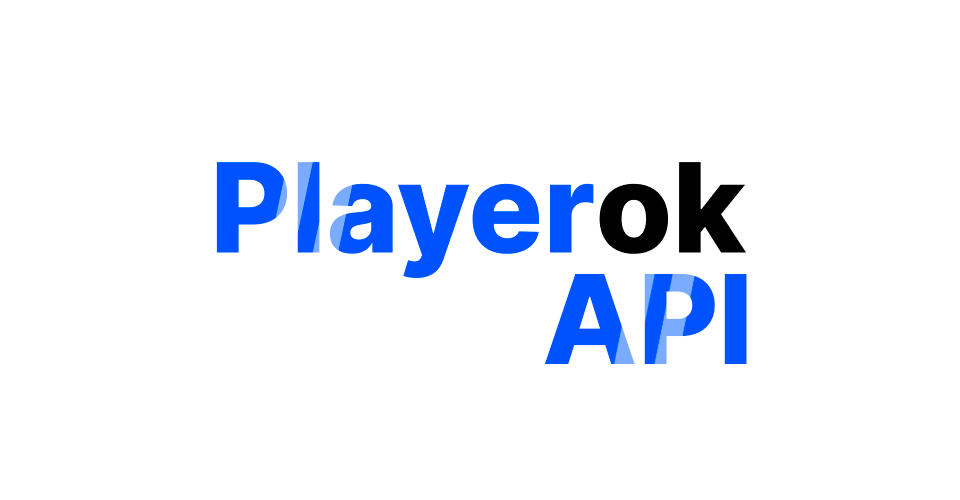

[](https://t.me/friedauto)
[](https://t.me/friedplayerok)
[](https://github.com/alleexxeeyy/playerok-universal)
[](https://www.python.org/downloads/release/python-3119/)
[](https://github.com/alleexxeeyy/PlayerokAPI/stargazers)
[](https://github.com/alleexxeeyy/PlayerokAPI/forks)

Неофициальный API для работы с торговой площадкой Playerok на ЯП python, основанный на запросах.

> **Версия 2.0 — асинхронная.** Старый синхронный API (`Account`, `EventListener`) пока остаётся внутри пакета по старым путям и будет удалён в 3.0.
> Как перейти — в [MIGRATION.md](MIGRATION.md).

## Навигация
- [Документация](https://playerokapi.readthedocs.io/ru/latest/)
- [Установка](#установка)
- [Примеры использования](#примеры-использования)
- [Переход с 1.x](MIGRATION.md)
- [Полезные ссылки](#полезные-ссылки)

## Установка
Нужен **Python 3.11+**.

```
pip install git+https://github.com/alleexxeeyy/PlayerokAPI.git
```

Старая 1.x: `pip install git+https://github.com/alleexxeeyy/PlayerokAPI.git@v1`

> Пакет `playerokapi` на PyPI — **чужая** библиотека с тем же именем, не ставьте его вместо этой.

## Примеры использования

### Быстрый старт
Бот, который отвечает на несложные команды. Хендлеры вешаются декораторами на роутер, фильтры пишутся через `F`.

```python
import asyncio
from datetime import datetime

from playerokapi import Client, Dispatcher, Router, F, NewMessageEvent

router = Router()


@router.new_message(F.message.text == "!команды")
async def on_commands(event: NewMessageEvent):
    await event.answer("🤖 Доступные команды:\n- !привет - отправляет приветствие\n- !дата - показывает текущую дату и время")


@router.new_message(F.message.text == "!привет")
async def on_hello(event: NewMessageEvent):
    await event.answer("👋 Привет, я бот для Playerok!\n- Узнать команды - !команды")


@router.new_message(F.message.text == "!дата")
async def on_date(event: NewMessageEvent):
    await event.answer(f"📅 Текущая дата: {datetime.now().strftime('%d/%m/%Y, %H:%M:%S')}")


async def main():
    async with Client(
        cookies="token=eyJhbGciOiJIUzI1NiIsInR5cCI6IkpXVCJ9...; __ddg1_=...",
        user_agent="Mozilla/5.0 (Windows NT 10.0; Win64; x64) AppleWebKit/537.36 (KHTML, like Gecko) Chrome/143.0.0.0 Safari/537.36"
    ) as client:
        dp = Dispatcher(client)
        dp.include_router(router)
        await dp.run()


asyncio.run(main())
```

Свои сообщения в события не попадают, поэтому проверять `event.message.user.id != client.id` не нужно.

Куки берите из браузера, в котором вы авторизованы на Playerok, целиком. Куки защиты DDoS-Guard (`__ddg*`) привязаны к IP и User-Agent, поэтому запросы должны идти с того же IP и с тем же `user_agent`.

### Новая сделка
```python
from playerokapi import Client, NewDealEvent, DealStatus


@router.new_deal()
async def on_new_deal(event: NewDealEvent, client: Client):
    deal = event.deal
    print(f"Новая сделка {deal.id}: {deal.item.name} за {deal.item.price} ₽ от {deal.user.username}")
    await event.answer("Спасибо за покупку! Сейчас всё выдам.")
    await client.update_deal(deal.id, DealStatus.SENT)
```

В хендлер можно получить по имени параметра `event`, `client`, `dispatcher`, `router` и всё, что вы положили в диспетчер: `dp["config"] = config` → параметр `config`.

### События без роутеров
```python
async with Client(cookies="...") as client:
    async for event in client.listen():
        if isinstance(event, NewMessageEvent):
            print(event.chat.id, event.message.text)
```

### Получение сообщений чата
Последние 24 сообщения в чате с пользователем «LexeyLex»

```python
chat = await client.get_chat_by_username("LexeyLex")
page = await client.get_chat_messages(chat.id)

for message in page.items:
    print(message.created_at, message.text)
```

Все списки возвращаются страницей `Page`: объекты лежат в `page.items`, курсор следующей страницы — в `page.page_info.end_cursor`.

### Свои предметы
```python
from playerokapi import ItemStatus

page = await client.get_my_items(statuses=[ItemStatus.APPROVED, ItemStatus.EXPIRED])
for item in page.items:
    print(item.name, item.price, item.status)
```

### Создание и публикация предмета
Предмет в приложении «Telegram», категории «Подарки (NFT)»

```python
game = await client.get_game(slug="telegram")

_category = next(cat for cat in game.categories if cat.name == "Подарки (NFT)")
category = await client.get_game_category(id=_category.id)

obtaining_types = await client.get_game_category_obtaining_types(category.id)
obt_type = next(obt for obt in obtaining_types.items if obt.name == "Подарок")

option = next(opt for opt in category.options if opt.value == "heart")

data_fields = await client.get_game_category_data_fields(category.id, obt_type.id)
data_field = next(df for df in data_fields.items if df.label == "Комментарий")
data_field.value = "Напишу вам в ТГ после оформления заказа"

item = await client.create_item(
    game_category_id=category.id,
    obtaining_type_id=obt_type.id,
    name='Подарок "❤️ Сердце" (13 ⭐) / Авто-Выдача 🤖',
    price=90,
    description="Выдача осуществляется без захода на ваш аккаунт.",
    options=[option],
    data_fields=[data_field],
    attachments=["banner.png"]
)

statuses = await client.get_item_priority_statuses(item.id, item.price)
free_status = next(status for status in statuses if status.price == 0)
await client.publish_item(item.id, free_status.id)
```

### Вызов из обычных потоков
Если часть кода синхронная и работает в отдельных потоках, используйте `ThreadsafeClient` — те же методы, но без `await`:

```python
from playerokapi import ThreadsafeClient

sync_client = ThreadsafeClient(client, asyncio.get_running_loop())
# в другом потоке:
chats = sync_client.get_chats()
```

## Полезные ссылки
- Разработчик: https://github.com/alleexxeeyy (в профиле есть актуальные ссылки на все контакты для связи)
- Telegram канал: https://t.me/friedauto
- Telegram канал Playerok бота: https://t.me/friedplayerok
- Telegram бот для покупки официальных модулей: https://t.me/friedshopbot
